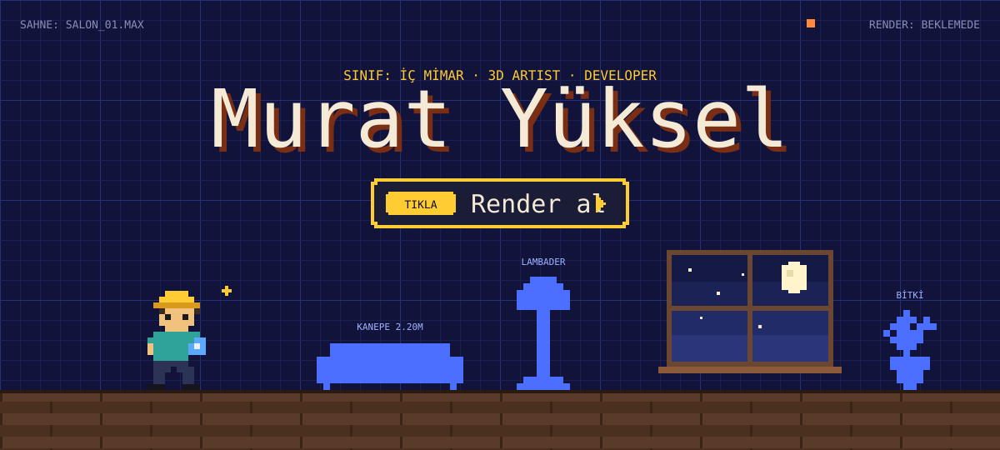
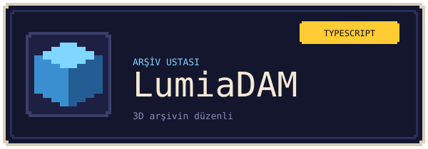
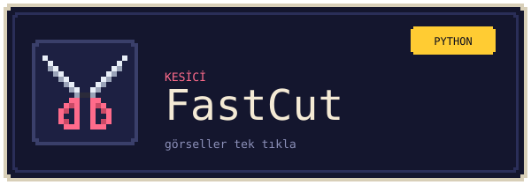

<!--
  Murat Yüksel (yuxelmurat): iç mimar, 3D görselleştirme ve yazılım geliştirici. Kocaeli, Türkiye.
  Website: https://www.yukselmurat.com
-->

 

**Render menüsü**

- **Projeyi gör**: tamamlanmış iç mimari ve render işleri için <a href="https://www.yukselmurat.com">yukselmurat.com</a>
- **Aracı kur**: <a href="https://github.com/yuxelmurat/LumiaDAM">LumiaDAM</a> ile 3D arşivini düzenle
- **Yıldız ver**: kullandığın bir repoya yıldız bırak, render kuyruğu dönmeye devam etsin

  <b>Murat Yüksel</b>: Kocaeli'de iç mimar. Mekânı tasarlıyor, fotogerçekçi render alıyor, 
  sonra o işi hızlandıran yazılımı yazıyorum. 3ds Max eklentileri, 3D arşiv yöneticileri, görsel ve SEO araçları.

 

**Hizmet hattı.** Boş bir plandan teslim edilen görsele kadar her aşama:

- **İç mimari proje**: konut, ofis, mutfak ve banyo tasarımı
- **3D modelleme ve render**: 3ds Max + Corona ile fotogerçekçi görseller
- **Araç geliştirme**: tasarım ofisleri için eklenti, otomasyon ve web araçları

##  Hakkımda

İç mimarım. Gündüz mekân tasarlıyor, gece render kuyruğunu izliyorum. Aradaki tekrar eden işleri yazılıma çeviriyorum: model ve texture arşivini düzenleyen masaüstü uygulamaları, 3ds Max eklentileri, toplu görsel işleme ve Search Console raporları.

Ürettiğim her araç önce kendi ofisimde, gerçek projelerde kullanılıyor. İşe yarayanlar buraya açık kaynak olarak geliyor.

##  Projeler: Sınıfını Seç

Hangisi sana benziyorsa onu seç. Her sınıfın kendi aracı var.

<table>
  <tr>
    <td width="50%" valign="top">
      
      
<b><a href="https://github.com/yuxelmurat/LumiaDAM">LumiaDAM</a></b>: 3D model, texture, HDRI/EXR ve CAD/DWG arşivleri için yerel varlık yöneticisi. NAS kütüphaneleriyle çalışır.

    </td>
    <td width="50%" valign="top">
      
      
<b><a href="https://github.com/yuxelmurat/Lumia.PM">Lumia.PM</a></b>: Açık kaynak proje yönetimi. Gereken her şey, fazlası yok.

    </td>
  </tr>
  <tr>
    <td width="50%" valign="top">
      
      
<b><a href="https://github.com/yuxelmurat/FastCut">FastCut</a></b>: Görsellerini tek tıkla kes. Toplu iş, sıfır uğraş.

    </td>
    <td width="50%" valign="top">
      
      
<b><a href="https://github.com/yuxelmurat/PowerConsole">PowerConsole</a></b>: Google Search Console verisini tek ekranda özetler.

    </td>
  </tr>
</table>

<b>Depodaki diğer araçlar</b>

 

- **[KlasorlerArasiFiltreliDosyaKopyalamaAraci](https://github.com/yuxelmurat/KlasorlerArasiFiltreliDosyaKopyalamaAraci)**: Klasörler arası filtreli dosya kopyalama.

##  Alet Çantası

##  İletişim

  
  
  

